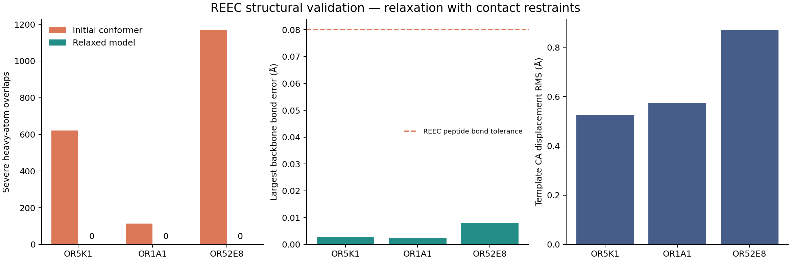

# REEC validation examples

The examples below use 9,000 relaxation iterations per candidate and two candidate starts.
All three pass the engine's publication checks and an independent audit of the serialized PDB.
Distances are in Angstroms; twist errors are in degrees.

| Receptor | Workflow | Initial overlaps | Final overlaps | Maximum backbone bond error | Maximum peptide twist error | Template CA RMS displacement |
| --- | --- | ---: | ---: | ---: | ---: | ---: |
| OR5K1 | Repair of a hazelnut-pyrazine dock | 621 | 0 | 0.0028 | 0.45 | 0.524 |
| OR1A1 | Homology modeling from the composite 8uxy template | 114 | 0 | 0.0024 | 0.68 | 0.574 |
| OR52E8 | Class I IC reshape, loop rebuild, and relaxation | 1170 | 0 | 0.0081 | 1.27 | 0.871 |

“Initial” describes the complete candidate after template transfer and loop initialization,
before REEC relaxation. These counts use the project radii and exclusion graph; they are not
MolProbity clashscores. The independent audit checks atom inventories, backbone bonds, peptide
angles and planarity, alpha and beta stereochemistry, disulfide geometry, and mandatory contacts.
It does not evaluate Ramachandran populations, model accuracy against a hidden experimental
structure, or docking efficacy.

All six declared disulfides survive. Y6.55–D45.51 remains within its mandatory bounds in OR5K1 and
OR1A1; R4.52–D5.50 remains within its bounds in OR52E8. All eleven ligand heavy atoms in the OR5K1
repair retain their original numerical coordinates, with zero coordinate RMS displacement.
The final coordinates, contacts, and complete geometry metrics appear in [validation.json](validation.json).



The local models, optimizer reports, execution logs, and independent review are in
`tmp/reec-showcase/`. The original receptor model files were retained during these experiments.
Each example's workspace also retains its alignment, template, and contact file.

```sh
python3 hm/fixfail.py OR5K1 \
  out/OR5/OR5K1/OR5K1~hazelnut_pyrazine.active.model1.pdb \
  --backend reec --skip-reshape --output tmp/reec-showcase/OR5K1.active.pdb \
  --iterations 9000 --models 2 --keep-work

python3 hm/dohm.py OR1A1 --backend reec \
  --output tmp/reec-showcase/OR1A1.active.pdb \
  --iterations 9000 --models 2 --keep-work

python3 hm/fixfail.py OR52E8 --backend reec \
  --output tmp/reec-showcase/OR52E8.active.pdb \
  --iterations 9000 --models 2 --keep-work

python3 hm/reec_review.py tmp/reec-showcase/*.active.pdb \
  --output tmp/reec-showcase/review.json --plot tmp/reec-showcase/validation.png
```

The Class I run used the existing IC stage, and the saved IC template was reused for the final
relaxation. `OR52E8.reshape.log` retains the complete reshape log. The exact retained template
path appears in `OR52E8.log`. IC sampling can vary between runs. Plot generation uses Matplotlib;
the engine, adapters, and independent geometry audit have no Matplotlib dependency.
